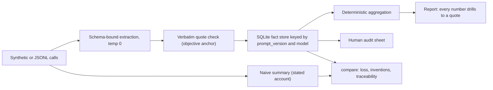

# call-transcripts-ai

**Auditable call-transcript summarization.** An LLM summary is a black box: convenient, confident, and impossible to check after the fact. You can't open the box and you can't make it deterministic — but you *can* box it in. Instead of asking a model to **summarize** (prose you have to trust), ask it to **extract** small, schema-bound facts that each carry a **verbatim quote**, verify those quotes mechanically, and do the counting in plain Python.

The result isn't certainty. It's **auditability**: every number drills down to a specific `{call_id, utterance_id, quote}`, so a human can follow the trail back to the words that were actually said and reconstruct a *possible explanation* for any claim.

> **The punchline:** black boxes can't be opened — but strategic facts and quotes buy you auditability, and a possible explanation.

It runs entirely on **synthetic, fictional** sales calls (for an invented analytics product called "Lumen"), and works against OpenAI **or a fully local model via [Ollama](https://ollama.com)** — no API key, nothing leaving your machine. All it needs from the model is a JSON response. No database, no customer data, nothing real.

> This is a teaching demo, not a product. The data is made up and the heuristics are intentionally simple so they stay auditable themselves.

## The one idea: anchor on the objective artifact, not the model's story

A summary is the model's **stated account** of the call — self-reported, and sometimes unfaithful to what was actually said. A verbatim **quote** is an objective artifact: it either appears in the transcript or it doesn't.

So this project treats each extracted fact as a **decision record, not a confession**: it pairs the model's interpretation (a typed label) with the objective evidence (a quote) and its provenance (`call_id`, `utterance_id`). The label can be wrong; the quote is checkable; the pairing is auditable.

> This is the same philosophy as the companion project [blackbox-ai](https://github.com/ranfysvalle02/blackbox-ai) ("a flight recorder for coding agents"), applied to a different domain. There, you anchor on objective artifacts like tool calls and diffs rather than the agent's stated chain-of-thought. Here, you anchor on the quote rather than the summary.



The LLM runs once per call, as an extractor. Everything downstream — grounding, caching, counting, ranking — is deterministic Python. Re-running yields identical numbers.

## Quickstart

```bash
pip install -r requirements.txt
```

**Fully local, no API key** (recommended for kicking the tires). Install [Ollama](https://ollama.com), then:

```bash
ollama pull llama3
python -m callintel run     --ollama --model llama3 --show-evidence
python -m callintel compare --ollama --model llama3 --out out/compare.md
```

**Or against OpenAI:**

```bash
cp .env.example .env         # then paste your key into OPENAI_API_KEY
python -m callintel run --show-evidence
python -m callintel compare --out out/compare.md
```

The rest of the commands work the same either way:

```bash
python -m callintel audit --sample 10   # human review sheet for spot-checking
python -m callintel selftest            # offline checks, no network, no model
```

The CLI auto-loads the nearest `.env` (walking up from your working directory). Set `LLM_BASE_URL` + `LLM_MODEL` there to make local the default, so plain `python -m callintel run` targets Ollama with no flags.

## Commands

| Command | What it does |
| --- | --- |
| `run` | `extract` then `report` in one shot. |
| `extract` | LLM-extract schema-bound facts per call, ground them, cache to SQLite. |
| `report` | Deterministic aggregation over the cached facts (`--show-evidence` to drill down, `--json` for machine output, `--narrative` for an optional grounded write-up). |
| `audit` | A human-in-the-loop review sheet: a random sample of facts to mark pass/fail. |
| `compare` | A naive free-form summary next to the grounded extraction, flagging **loss**, **inventions**, and **traceability** (`--call-id` for one call, `--out` to save). |
| `selftest` | Offline checks of the grounding, aggregation, and compare heuristics. |

Useful flags: `--ollama` (local Ollama, no key) or `--base-url URL` (any OpenAI-compatible server); `--model` (default `gpt-4o-mini` on OpenAI, `llama3.1` on local — or set `LLM_MODEL`); `--limit N`; `--taxonomy path.json` to swap the vocabulary; `--refresh` to ignore the cache.

### Running locally with Ollama

The tool uses the OpenAI-compatible Chat Completions API, so any server that speaks it works. For Ollama:

```bash
ollama serve &           # if not already running
ollama pull llama3       # or any chat model
python -m callintel run --ollama --model llama3 --show-evidence
```

`--ollama` targets `http://localhost:11434/v1` and sends a throwaway key (local servers ignore it). To point at a remote or different port, use `--base-url http://host:port/v1` or set `LLM_BASE_URL`. Structured output degrades automatically: strict JSON schema if the model supports it, otherwise a plain JSON object, otherwise prompt-enforced JSON — so smaller local models still work. (Smaller models label more noisily; that is exactly what grounding and `audit` are for.)

## Bring your own transcripts

Point any command at a JSONL export with `--jsonl`. One call per line; field names are matched leniently:

```json
{"call_id": "abc", "company_name": "Acme", "call_date": "2026-01-15",
 "utterances": [{"speaker_type": "customer", "snippet": "we evaluated it last quarter"},
                {"speaker_type": "rep", "snippet": "what held you back?"}]}
```

```bash
python -m callintel run --jsonl data/sample_calls.jsonl --cohort my-export --show-evidence
```

`data/sample_calls.jsonl` ships as a ready-made example (it is the synthetic calls in JSONL form).

## What makes it auditable

You can't make a black box transparent. You *can* make its output small, local, and checkable. Each risk of "just summarize it" is met with a concrete mitigation in the code:

| Risk | Mitigation (where it lives) |
| --- | --- |
| **Lossy summaries** drop details | Extract small facts instead of prose, and measure what a summary loses with `compare` (`callintel/compare.py`). |
| **Hallucinated quotes** | Every fact's `quote` must be a verbatim substring of the shown utterances, or it is flagged ungrounded. The quote is the objective anchor (`validate_grounding` in `callintel/core.py`). |
| **Inconsistent labels** between runs | Closed vocabularies with deterministic coercion onto known buckets (`DEFAULT_TAXONOMY`, `coerce_enum`). |
| **Counts that drift** run to run | One LLM call per transcript; all aggregation is plain Python (`aggregate_facts`). Re-running gives identical numbers. |
| **Silent model / prompt drift** | `prompt_version` + model are part of the cache key and are stamped on every fact; change the prompt and old facts are transparently superseded. |
| **Narrative spin** | The optional `--narrative` may only restate already-computed numbers and must cite evidence; it cannot introduce new facts (`render_narrative`). |
| **Unverified output** | A human-in-the-loop `audit` sheet makes spot-checking a first-class step. |

Together these turn "the AI said so" into "here is the quote, the call, and the line — go check it." That is the difference between a black box and an auditable one: not certainty, but a trail to a *possible explanation*.

## Honest limitations

- **Grounding proves a quote exists, not that its label is correct.** The quote is the objective artifact; the label is still the model's *stated* interpretation and can be wrong. That is exactly why `audit` exists — auditability means a human can actually do the audit.
- **The `compare` loss and invention checks are lexical heuristics**, not an NLP judge. Coverage is a content-word overlap test; invention detection is a digit-sequence / proper-noun presence test. They are deliberately simple so they are auditable, and they err toward under-claiming. See the docstrings in `callintel/compare.py`.
- **The data is synthetic.** The calls, companies, competitors, and numbers are all invented to exercise the pipeline and to plant summarization traps.

## Layout

```
callintel/
  core.py        # source-agnostic pipeline: taxonomy, grounding, fact store, aggregation, report
  llm.py         # OpenAI Responses-API client (temp 0, strict JSON schema, graceful degrade)
  compare.py     # naive summary vs grounded extraction: loss / inventions / traceability
  cli.py         # `python -m callintel ...`
  adapters/
    base.py      # the CallSource protocol
    synthetic.py # baked-in fictional sample calls
    jsonl.py     # bring-your-own JSONL export
data/sample_calls.jsonl
```

## Related

- [blackbox-ai](https://github.com/ranfysvalle02/blackbox-ai) — a flight recorder for coding agents. Same philosophy (black-box AI made auditable by anchoring on objective artifacts, treating captures as decision records), different domain.
- [blog.md](blog.md) — the longer argument and a worked `compare` example.

## License

MIT. See [LICENSE](LICENSE).
