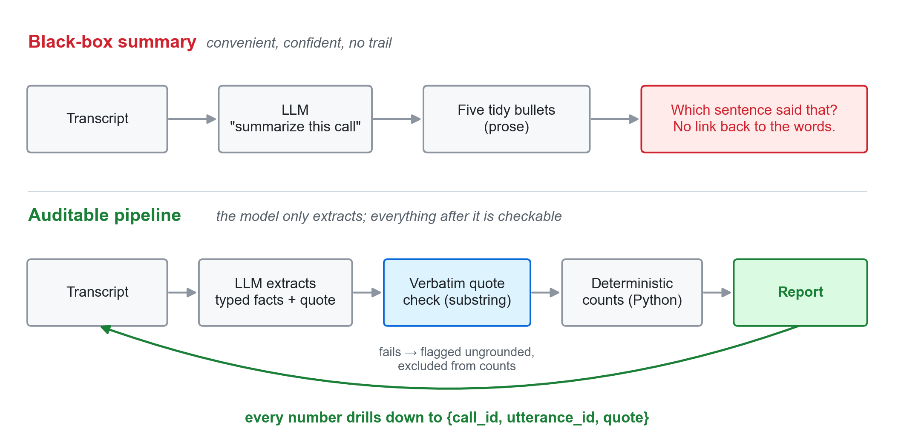
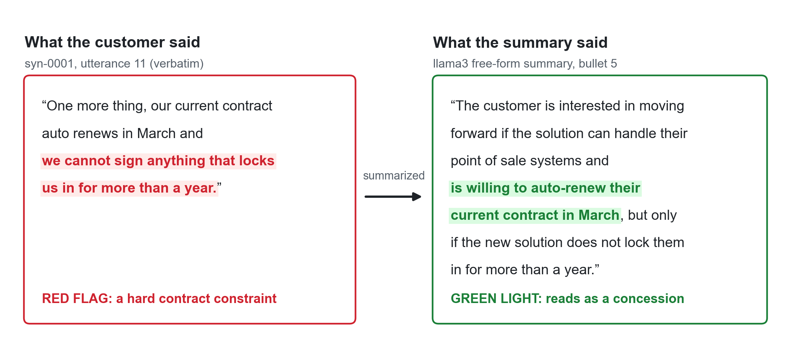
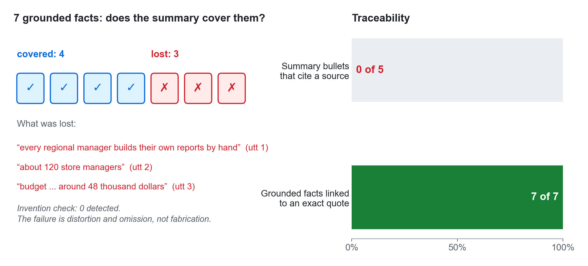
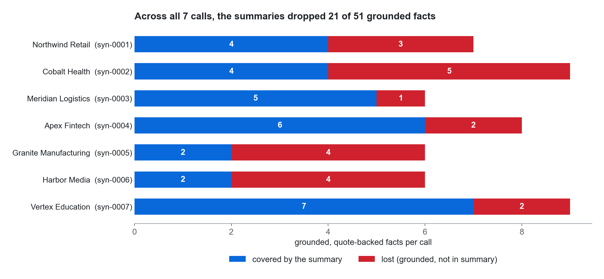

# Your call summaries are quietly lying to you

### Why free-form LLM call summaries fail in production — and how verbatim-quote extraction makes them auditable.

> A worked example of why "just summarize the call" is riskier than it looks, and six concrete things to do about it. All code and data are at [github.com/ranfysvalle02/call-transcripts-ai](https://github.com/ranfysvalle02/call-transcripts-ai); the calls are synthetic.
>
> This is a companion to [blackbox-ai](https://github.com/ranfysvalle02/blackbox-ai), a "flight recorder" for coding agents. Same idea, different domain: when the machine won't tell you the truth about why, stop trusting its story and anchor on the objective artifacts it leaves behind.



*Top: the usual path, where the summary becomes the record and nothing links back to the words. Bottom: the model only extracts; the quote check and the counting are mechanical, so every number traces back to a call, an utterance, and a quote.*

## 1. The seductive summary

You just got off a 40-minute customer call. You paste the transcript into a model, ask for five bullets, drop them into the CRM, and move on.

It feels like a free win. It isn't. That summary is now the *system of record* for what the customer said, and it came from a process that is **lossy by design** and **impossible to audit after the fact**. Nobody will reread the transcript. The bullets are the truth now.

Every expensive, mysterious machine eventually gets a flight recorder, because "it seemed fine" is not an answer when something breaks. An LLM summarizing your calls is that kind of machine, and by default it flies blind. Three weeks later the deal slips, someone asks *"what did they actually say about the contract?"*, and all you have is a paraphrase of a paraphrase. The words evaporated when the summary was written.

## 2. Summarization is lossy by definition

A summary's job is to throw information away. The problem is *which* information — and the model decides silently, differently each time.

Take one synthetic call from the repo: Northwind Retail, `syn-0001`. The customer says, in their own words:

- "Honestly the dashboards are **not** the problem for us" — then the rep guesses "so performance is really your top concern", and the customer pushes back: "**Maybe, but I would not say performance**, it is really about trusting that the numbers are right."
- "The budget we have approved is around **48 thousand** dollars for the year."
- And in the very last turn: "our current contract **auto renews in March** and we cannot sign anything that locks us in for more than a year."

Here is what `compare` produced for that call, running **fully locally on Ollama (`llama3`), with no API key**. The summary is the model's real output; everything below it is the tool's deterministic analysis (`python -m callintel compare --ollama --model llama3 --call-id syn-0001`):

```markdown
## Northwind Retail  (`syn-0001`)

### Naive summary (free-form, no grounding)
• Northwind Retail is currently using spreadsheets to build reports, which takes most of a day every week.
• The company has a budget of $48,000 for the year and is looking for a solution that fits within that budget.
• The main pain point is getting clean data into dashboards, as they pull from four different point of sale systems.
• Query performance is a concern, but more importantly, the customer wants to trust that the numbers are accurate.
• The customer is interested in moving forward if the solution can handle their point of sale systems and is willing to auto-renew their current contract in March, but only if the new solution does not lock them in for more than a year.

### What the grounded extraction found
7 grounded, quote-backed facts. The summary covers 4, and misses 3.

#### Lost facts (grounded, but absent from the summary)
- **interest/self_serve_reporting** - (customer) "Right now every regional manager builds their own reports by hand in spreadsheets, and it eats most of a day every single week."  [syn-0001 / utt 1]
- **interest/team_velocity** - (customer) "We have about 120 store managers who would need access to this."  [syn-0001 / utt 2]
- **interest/cost_reduction** - (customer) "The budget we have approved is around 48 thousand dollars for the year, so pricing really matters to us."  [syn-0001 / utt 3]

#### Likely inventions (in the summary, not in the transcript)
- None detected by this heuristic.

#### Traceability
- Summary bullets that cite a source: 0 of 5.
- Grounded facts that link to an exact quote {call_id, utterance_id, quote}: 7 of 7.
```

Read it closely. This came from a small 8B model on a laptop, which makes the point sharper, not weaker.



*The most dangerous line in the summary. The customer's hard limit on lock-in (left, verbatim) comes back as willingness to auto-renew (right). The limit survives as a trailing clause; the headline is a concession the customer never made.*

- **A hard constraint became a concession.** The customer "cannot sign anything that locks us in for more than a year." The summary says they are "**willing to auto-renew their current contract in March**." A red flag, written up as a green light. This is the most dangerous failure mode: the summary is confidently *wrong*, not merely incomplete.
- **The pushback got flattened.** The customer said "I would not say performance," yet the fourth bullet opens with "Query performance is a concern." The qualifier survives; the emphasis is inverted.
- **A specific number vanished.** "120 store managers" — the entire scope of the deal — is gone.
- **The texture is lost.** "every regional manager builds their own reports by hand" becomes "using spreadsheets to build reports." Close enough to feel faithful, lossy enough that you can't tell *who* does *what*.

The invention check came back empty: this model didn't fabricate a number or a name. It *distorted* and *dropped* — the quieter, more common failure. Coverage is strict on purpose: `$48,000` appears in the summary, yet the 48-thousand fact still counts as lost, because coverage wants the customer's *actual words*, not a paraphrase you can't trace back. The heuristics are signal, not a verdict, but the direction is clear: the summary reads beautifully, and it is not safe to trust.



*`syn-0001` by the numbers: of 7 quote-backed facts, the summary covers 4 and loses 3. None of its 5 bullets cites a source; all 7 extracted facts link to an exact quote.*

It isn't one unlucky call. Across all seven synthetic calls, the summaries dropped 21 of 51 grounded facts, and not one of their 35 bullets cites a source.



*The same local `llama3` run across all seven calls ([raw output](https://github.com/ranfysvalle02/call-transcripts-ai/blob/main/assets/compare_all_llama3.md)). Each bar is one call's quote-backed facts, split into the ones its summary covers and the ones it loses.*

## 3. The black box: why you can't just ask it to be better

Beyond lossiness, a raw summary has three properties that make it unauditable:

- **Non-determinism.** Ask twice, get two summaries. Which one is "the call"? Any metric built on top of them (objection counts, win/loss themes) silently drifts.
- **Silent model and prompt drift.** The vendor upgrades the model; someone tweaks the prompt. Yesterday's summaries and today's are no longer comparable, and nothing records that the rules changed.
- **No provenance.** A bullet says "performance is their main concern." Where in the 40 minutes did they say that? Nothing links the claim to the evidence, so it can never be checked — only trusted.

And here's the part people miss: **you can't fix this by asking the model to explain itself.** Ask "why did you say performance?" and you get *another* generated paragraph: a plausible, confident story that may have nothing to do with what actually drove the output. The model's self-report is the convenient signal, not the trustworthy one. [blackbox-ai](https://github.com/ranfysvalle02/blackbox-ai) draws the same lesson about a coding agent's chain-of-thought: treat a capture as a **decision record, not a confession**.

"The AI said so" and "the AI said it did so for this reason" are both just the AI talking.

## 4. Mitigation: box the model in

You can't make an LLM deterministic or omniscient, and you can't trust its account of itself. But you can box it in so its mistakes are *small, local, and checkable*, and so the record you keep is anchored on something objective. Here is the recipe.

### 4.1 Extract, don't summarize
Ask the model for a list of small, typed facts, not prose. *Objection · contract terms · "we cannot sign anything that locks us in for more than a year"* is a tiny claim you can verify. Prose is a blob you can't. A JSON schema pins down the shape of every answer.

### 4.2 Anchor on the objective artifact: check every quote mechanically
This is the keystone. Every fact must carry a quote, and that quote must be a **verbatim substring** of the utterances the model was shown. If it isn't, the fact is flagged *ungrounded* and left out of the counts.

The quote is the objective artifact, the equivalent of a diff or a tool call in agent-land. The *label* on top of it ("this is a contract-terms objection") is the model's interpretation and can be wrong. The quote either exists in the transcript or it doesn't: a string check, not a judgment call. A hallucinated quote can't survive it.

### 4.3 Use closed vocabularies
Every label comes from a fixed list (pricing, contract terms, dashboards, ...). Anything off the list is mapped to the nearest known bucket, or to "other". This is what keeps "pricing", "price sensitive", and "too expensive" from becoming three different categories.

### 4.4 Move determinism upstream, and version everything
The LLM runs exactly once per transcript, as an extractor. Every count, ranking, and time window after that is plain Python over the cached facts, so re-running the report gives byte-identical numbers; no model touches the arithmetic. The cache is keyed on source, call, prompt version, and model, and the prompt version and model are stamped on every stored fact. Change either one and the old facts are superseded, so you can always tell which rules produced which number.

### 4.5 Generate the narrative last, and keep it on a leash
If you want prose at the end, generate it *from the already-computed aggregates* and require it to cite the evidence. The optional `--narrative` restates numbers that were computed deterministically; it may not introduce a fact that isn't already in the evidence list.

### 4.6 Keep a human in the loop, and measure the loss
Grounding proves a quote is real, not that its *label* is right. The `audit` command prints a random sample of facts with their quotes so a person can mark each one pass/fail; auditability means someone can actually do the audit. And `compare` makes the loss visible instead of pretending it isn't there: per call, which grounded facts a summary dropped, what it appears to have invented, and how little of it is traceable.

## 5. From a black box to a possible explanation

We never opened the black box. We never got the model to explain itself truthfully. We still ran a stochastic model we don't fully understand.

But look at the difference in what we can *say* afterward:

- **Before:** "The customer is willing to auto-renew their current contract in March." Source: a summary. Confidence: total. Checkability: none. If it's wrong — and it is — you'll never know why.
- **After:** "A contract-terms concern was raised on call `syn-0001`, at utterance 11, where the customer said *'our current contract auto renews in March and we cannot sign anything that locks us in for more than a year.'*"


*The real stored record for utterance 11 from this run. The model's label (an interest in self-serve reporting) is wrong; the quote and its location are right, which is exactly what lets a reviewer correct it to a contract-terms objection in seconds.*

The second statement is not certainty: in this very run the small model filed that quote under the wrong category. But it is **auditable**. A human jumps to utterance 11, reads the sentence, sees a *constraint* rather than a willingness, and fixes the label. The claim is pinned to an objective artifact and a location, so you can reconstruct a *possible explanation* for any number in the report — and defend it, or catch the error. Strategic facts and verbatim quotes don't make the model transparent; they give you a trail back to the words that were actually said. That is the whole trade: black boxes can't be opened, but strategic facts and quotes buy you auditability, and a possible explanation. Auditability instead of blind trust. A possible explanation instead of a shrug.

## 6. What this does *not* solve

- **Grounding is not correctness.** A verbatim quote can still carry the wrong label. The mechanical check catches fabrication, not misclassification; hence the human audit.
- **A grounded quote can be meaningless on its own.** The rep asks "Would annual lock-in kill the deal?" and the customer replies "Yeah, completely." That quote is 100% grounded and 0% informative: the meaning lives in the question. The fix is to ground on utterance pairs, storing the preceding turn (or a small context window) with the quote, so the evidence can be read on its own.
- **The `compare` heuristics are lexical.** Coverage is a content-word overlap test; invention detection checks whether digit sequences and proper nouns appear in the transcript. They're simple so they stay auditable themselves, and they misfire: in the seven-call run, both flagged "inventions" were just capitalized sentence openers ("Current", "Currently"). Signal, not a verdict.
- **Real transcripts are noisy, and strict matching costs recall.** These calls are clean text. Real speech-to-text output has odd punctuation, filler words, and inconsistent spelling, and models quietly tidy it up when they quote. A strict substring check (even with the whitespace and case normalization used here) will then reject a *valid* "auto-renews" against a transcript that says "auto renews." On real data, trade some strictness for recall — normalize punctuation, or fall back to near-substring matching — and accept that grounding becomes high-precision rather than perfect.
- **Extraction has its own cost.** One LLM call per transcript, a taxonomy to maintain, a schema to evolve. In exchange you get numbers you can defend. For a throwaway personal note, a plain summary is fine. For anything that feeds a decision, it isn't.

## 7. Try it yourself

Everything above ran on a laptop with no OpenAI account. The tool speaks the OpenAI-compatible Chat Completions API, so it runs against OpenAI *or* a fully local model via [Ollama](https://ollama.com); all it needs from the model is a JSON response.

```bash
pip install -r requirements.txt

# Fully local, no API key: just `ollama serve` + `ollama pull llama3`
python -m callintel run     --ollama --model llama3 --show-evidence
python -m callintel compare --ollama --model llama3 --out out/compare.md

# ...or against OpenAI
export OPENAI_API_KEY=sk-...
python -m callintel run --show-evidence

python -m callintel audit --sample 10          # the human-in-the-loop step
python -m callintel selftest                   # offline, proves the checks work
```

Swap in your own transcripts with `--jsonl your_calls.jsonl`. The [README](https://github.com/ranfysvalle02/call-transcripts-ai#what-makes-it-auditable) maps each of the six mitigations to the code that implements it. The model still makes mistakes — you watched a laptop-sized one make several — but now every mistake is small, local, and something you can see, trace, and explain.
